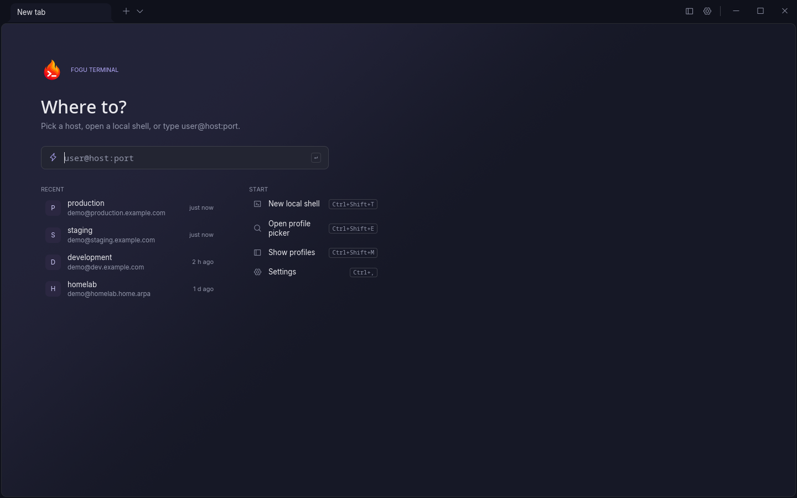
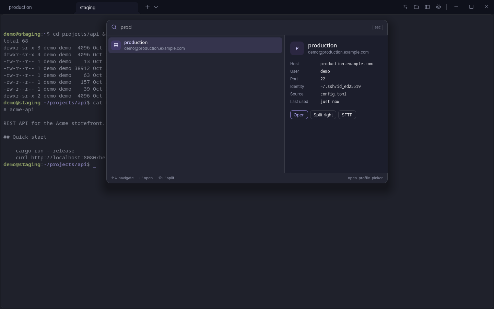
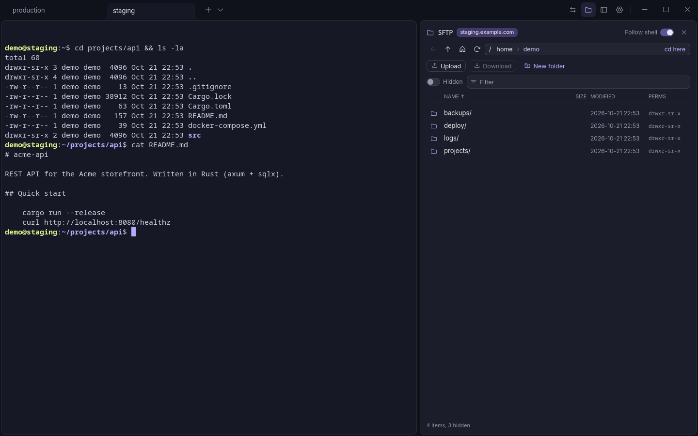
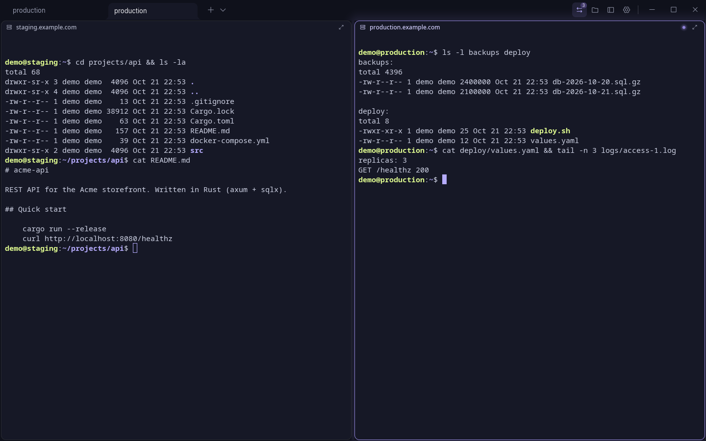
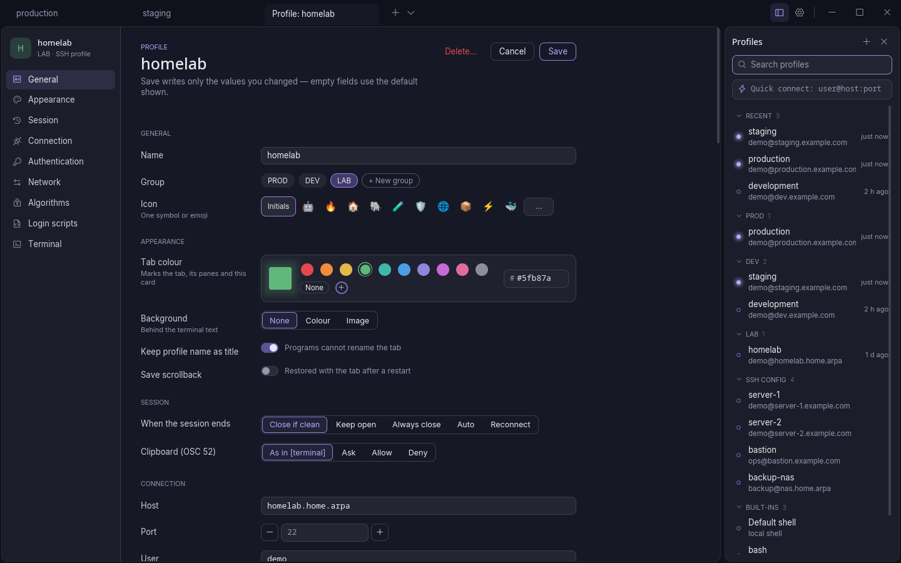
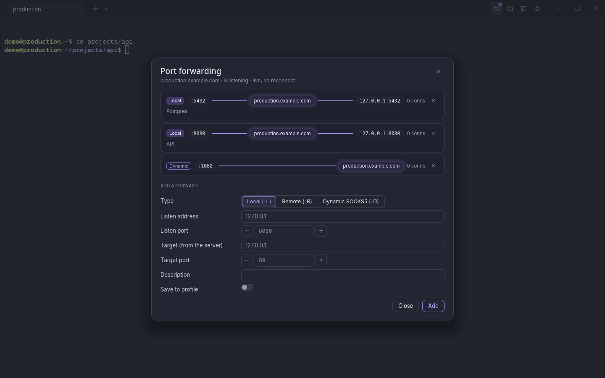
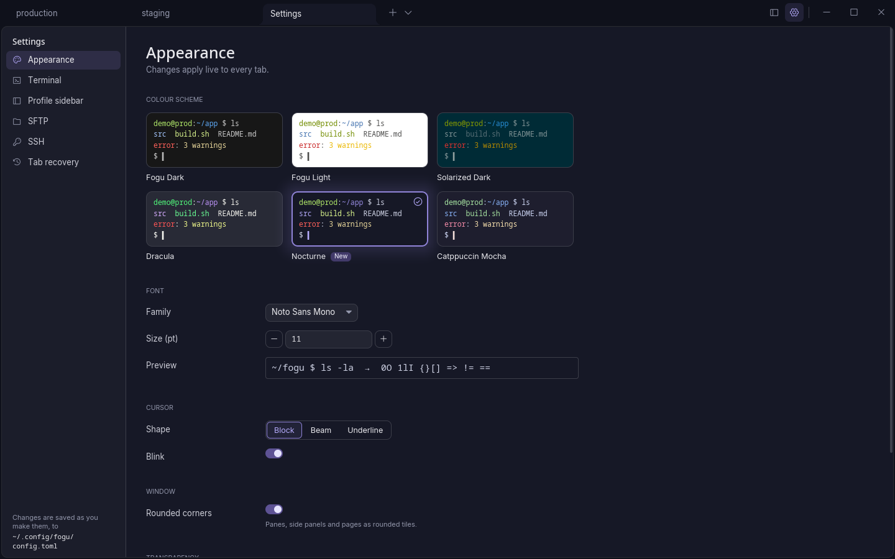

<p align="center">
  
</p>

<h1 align="center">Fogu Terminal</h1>

<p align="center">
  <strong>A native terminal for Linux and macOS with a built-in SSH manager and SFTP browser.</strong><br>
  Written in Rust. No browser engine, no compromises on your daily workflow.
</p>

<p align="center">
  
  
  
  
  
</p>

---

> **Fogu is in beta.** It is used daily, but expect rough edges and breaking changes to the
> configuration format before 1.0. Bug reports and feedback are very welcome.

## Screenshots

<p align="center">
  
</p>
<p align="center"><em>Start page: a second window opens here, clean, while the first one keeps your tabs.</em></p>

<p align="center">
  
</p>
<p align="center"><em>Profiles sidebar: groups, a dot on every live host, every host from <code>~/.ssh/config</code>.</em></p>

<p align="center">
  
</p>
<p align="center"><em>Quick picker (<code>Ctrl+Shift+E</code>): type a few letters, press Enter; Shift+Enter splits.</em></p>

<p align="center">
  
</p>
<p align="center"><em>SFTP panel on the same connection as the shell.</em></p>

<p align="center">
  
</p>
<p align="center"><em>Split panes, each on its own host; the focused one glows.</em></p>

<p align="center">
  
</p>
<p align="center"><em>Profile page: one scrolling page, only the values you change are written to <code>config.toml</code>.</em></p>

<p align="center">
  
</p>
<p align="center"><em>Port forwarding: local, remote and SOCKS5 routes, managed live.</em></p>

<p align="center">
  
</p>
<p align="center"><em>Settings (<code>Ctrl+,</code>): changes apply live to every tab.</em></p>

## Why Fogu

Most terminals that ship a decent SSH manager are web apps in disguise: a few hundred megabytes of
browser engine to draw a grid of characters. The native alternatives are fast, but leave you
juggling `~/.ssh/config`, a separate SFTP client and a password manager.

Fogu is the terminal built for people who live on remote servers. Open the sidebar, click a host,
and you are in a shell. Open the SFTP panel and you are browsing the same machine, on the same
connection, already in the directory your shell is in. Everything starts in about a tenth of a
second and stays out of your way.

*Fogu* means *fire* in Sardinian.

## Features

### Terminal
- GPU rendering with [iced](https://iced.rs) (wgpu), automatic CPU fallback for broken drivers and VMs
- Terminal emulation by [`alacritty_terminal`](https://github.com/alacritty/alacritty): fast, correct, battle-tested
- Tabs with rename, colour and backgrounds (colour or image); split panes, resizable with the mouse
- Drag and drop for tabs, panes and profiles; maximize, equalize and resize from the keyboard
- Scrollback, mouse selection, copy to PRIMARY and CLIPBOARD, safe multi-line paste
- Mouse reporting for TUI apps, with Shift to override
- Clickable links: OSC 8 hyperlinks plus detected URLs and paths, behind a scheme allow-list
- Context menus everywhere, configurable right-click behaviour
- Tab recovery: layout and recent scrollback come back after a restart (opt-out). A second
  window opened while Fogu runs starts clean on the start page and leaves the saved tabs alone
- Start page with quick connect, recent hosts and the usual shortcuts
- Settings page: colour scheme gallery, fonts, cursor, terminal, sidebar, SFTP and recovery
  options, applied live and written to `config.toml`
- Built-in schemes: Fogu Dark, Fogu Light, Solarized Dark, Dracula, Nocturne, Catppuccin Mocha;
  fonts, cursor and every key binding configurable

### SSH manager
- Sidebar with groups, search and quick connect (`user@host:port`)
- Reads your `~/.ssh/config` live (Host, HostName, User, Port, IdentityFile, ProxyJump,
  ProxyCommand, HostKeyAlias…) — no import step, nothing duplicated
- Profile page that edits `config.toml` in place, keeping your comments and writing only the
  values you change: groups, icon, tab colour, background, authentication, network, scripts
- Password, public key, ssh-agent and keyboard-interactive authentication
- Strict `known_hosts` checking: a changed host key is never accepted silently
- Jump hosts, proxy commands, SOCKS5 and HTTP proxies — a proxied profile never falls back to a
  direct connection
- Port forwarding: local, remote and dynamic (SOCKS5), managed live from a dialog
- Agent and X11 forwarding (off by default, clearly flagged when on)
- Connection reuse: tabs, splits and SFTP for the same host share one SSH connection
- Passwords and key passphrases stored in the desktop keyring (Secret Service, or the Keychain
  on macOS), never on disk
- Login scripts, starting directory, remembered directory, automatic reconnect with backoff

### SFTP browser
- Side panel on the same SSH connection: no second login
- Follows the shell's working directory as you `cd`
- Upload, download, drag and drop, rename, delete, new folder, permissions
- Transfers with progress, cancel and resume
- Hardened against hostile servers: sanitised names, disk-fill protection, downloaded files never
  executable, nothing is ever launched from a remote listing

## Install

Linux (X11 and Wayland), macOS (Apple Silicon and Intel) and Windows 10/11 (alpha). No root needed.

### Linux

```bash
curl -fsSL https://github.com/Revdep/Fogu/releases/latest/download/Fogu-linux-x86_64.tar.gz | tar xz
cd Fogu-linux-x86_64 && ./scripts/install.sh
```

Or the single-file AppImage:

```bash
curl -fsSLo Fogu.AppImage https://github.com/Revdep/Fogu/releases/latest/download/Fogu-x86_64.AppImage
chmod +x Fogu.AppImage && ./Fogu.AppImage
```

Needs glibc 2.35 or newer (Ubuntu 22.04, Debian 12, Fedora 36, Arch Linux).

### macOS

```bash
curl -fsSL https://github.com/Revdep/Fogu/releases/latest/download/Fogu-macos-aarch64.tar.gz | tar xz
cd Fogu-macos-aarch64 && ./scripts/install.sh
```

On Intel Macs use `macos-x86_64` instead of `macos-aarch64`. Fogu then shows up in Applications.

Downloaded with a browser instead of `curl`? Fogu is not notarized by Apple, so unblock it first:

```bash
xattr -dr com.apple.quarantine Fogu-macos-*
```

<details>
<summary>Good to know on macOS</summary>

- **Option key:** Option + a letter is Meta (`Option+f` = word forward); Option + other keys types
  the character (`@`, `#`, `[`, `~`). If your layout puts characters on Option + a letter
  (German `@` = Option+L), set `alt_is_meta = false` under `[terminal]`.
- **Cmd key:** `Cmd` + a key that is not a Fogu shortcut does nothing, as in Terminal.app.
- **Locale:** shells started from Finder or the Dock get `LANG` from the system language.
- **Passwords** are stored in the login Keychain (service `fogu`). After an update macOS may ask
  once to allow access.
- **Cmd+Q** skips the final save: tabs come back, the last ~30 s of scrollback may not.

</details>

### Windows (alpha)

Windows 10 or 11, x86_64. In PowerShell:

```powershell
curl.exe -fsSLo Fogu.zip https://github.com/Revdep/Fogu/releases/latest/download/Fogu-windows-x86_64.zip
Expand-Archive Fogu.zip -DestinationPath $env:LOCALAPPDATA\Programs
& "$env:LOCALAPPDATA\Programs\Fogu-windows-x86_64\fogu.exe"
```

To remove it, delete that folder.

<details>
<summary>Good to know on Windows</summary>

- **SmartScreen:** Fogu is not code-signed, so the first launch may show "Windows protected your
  PC": choose *More info* → *Run anyway*.
- **From source:** with [rustup](https://rustup.rs), `cargo install --path crates/app --locked`
  in a clone of this repository.
- **Shell:** new tabs open `pwsh`, then Windows PowerShell, then `cmd`, whichever is found first.
- **Config** lives in `%APPDATA%\fogu\config.toml`; hosts are read from `%USERPROFILE%\.ssh\config`.
- **Passwords** are stored in the Windows Credential Manager.
- **SSH agent:** Fogu uses the Windows OpenSSH agent. Start it once in an admin PowerShell with
  `Set-Service ssh-agent -StartupType Automatic; Start-Service ssh-agent`.
- **Closing a tab** ends everything started in it, except programs that detach themselves
  (`start`).
- **Alpha limits:** a new tab or split opens in the current folder only when the shell reports it
  (OSC 7), and the "command finished" notification is not available yet.

</details>

### From source

```bash
git clone https://github.com/Revdep/Fogu.git
cd Fogu && ./scripts/install.sh
```

Needs [rustup](https://rustup.rs) (it picks the right Rust version). Plus, on Debian/Ubuntu:

```bash
sudo apt install build-essential pkg-config libudev-dev libxkbcommon-dev libwayland-dev
```

on Arch Linux:

```bash
sudo pacman -S --needed base-devel pkgconf systemd-libs libxkbcommon wayland
```

and on macOS:

```bash
xcode-select --install
```

### Uninstall

```bash
./scripts/install.sh --uninstall
```

## Configuration

Fogu works with no configuration. To customise it, edit `~/.config/fogu/config.toml`:

```toml
[appearance]
color_scheme = "Dracula"   # built in: Fogu Dark, Fogu Light, Solarized Dark, Dracula, Nocturne, Catppuccin Mocha

[[profiles]]
id = "home-server"
name = "Home server"
type = "ssh"
host = "server.lan"
user = "me"
```

Hosts from `~/.ssh/config` appear in the sidebar automatically.

### Default keys

| Action | Linux | macOS |
|---|---|---|
| New tab / close tab | `Ctrl+Shift+T` / `Ctrl+Shift+W` | `Cmd+T` / `Cmd+W` |
| Go to tab 1-9 | `Alt+1`..`Alt+9` | `Cmd+1`..`Cmd+9` |
| Profile picker | `Ctrl+Shift+E` | `Cmd+E` |
| Profiles sidebar / SFTP panel | `Ctrl+Shift+M` / `Ctrl+Shift+O` | `Cmd+Shift+M` / `Cmd+Shift+O` |
| Settings | `Ctrl+,` | `Cmd+,` |
| Split right / split down | `Ctrl+Shift+S` / `Ctrl+Shift+D` | `Cmd+Shift+D` / `Cmd+D` |
| Move between panes | `Ctrl+Alt+Arrows` | `Cmd+Option+Arrows` |
| Copy / paste | `Ctrl+Shift+C` / `Ctrl+Shift+V` | `Cmd+C` / `Cmd+V` |
| Clear | | `Cmd+K` |
| Zoom | `Ctrl+=` / `Ctrl+-` / `Ctrl+0` | `Cmd+=` / `Cmd+-` / `Cmd+0` |
| Full screen | `F11` | `Ctrl+Cmd+F` |

Every action can be rebound under `[hotkeys]`. `Cmd` and `Option` are accepted as modifier
names on every system (the same keys as `Meta` and `Alt`); macOS shows them that way.

### Command line

```
fogu [--config-dir PATH] [--software-render] [--no-recovery]
```

## Under the hood

Fogu is a Cargo workspace of five crates with one owner per concern:

| Crate | Role |
|---|---|
| `fogu-term` | Terminal state over `alacritty_terminal`, input encoding, OSC parsing, links |
| `fogu-session` | Local PTY and SSH sessions on Tokio: `russh`, SFTP, forwarding, proxies, keyring |
| `fogu-core` | Config, profiles, `~/.ssh/config` parsing, key map, colour schemes, split tree |
| `fogu-ui` | The iced application: tabs, panes, sidebar, SFTP panel, dialogs |
| `fogu` | The binary: command line, logging, crash log |

Design choices:

- **Pure Rust, no C crypto.** SSH via [`russh`](https://github.com/Eugeny/russh) on `ring`;
  `unsafe_code = "forbid"` for the whole workspace.
- **Remote text is attacker input.** Everything a server sends — terminal output, file names,
  banners, error messages — is sanitised before it reaches the UI or the logs.
- **Secrets stay secret.** Passwords live in `secrecy` types, never in messages, logs or errors,
  and are stored only in the desktop keyring.
- **Supply chain gate.** `cargo deny` checks advisories, licences and sources on every build; no
  vulnerability advisory is ever ignored.
- **Tested against the real thing.** Integration tests start a throwaway OpenSSH `sshd` and an
  in-process hostile SFTP server; parsers are fuzzed.

## Development

```bash
./scripts/check.sh    # fmt, clippy -D warnings, fuzz build, nextest, doc tests, cargo deny
cargo run             # debug build
```

The SSH integration tests need `sshd`, `ssh-keygen`, `ssh-agent` and `ssh-add`; without them they
are skipped.

## Contributing

Fogu is open to contributions: bug reports, ideas, documentation and code are all welcome.

- **Bugs and ideas:** open an [issue](https://github.com/Revdep/Fogu/issues) with steps to
  reproduce, your distribution and desktop (X11 or Wayland), or your macOS version.
- **Code:** fork, branch, and open a pull request. Keep changes focused, add a test for new
  logic, and make sure `./scripts/check.sh` passes.
- **Security issues:** please report them privately through
  [GitHub security advisories](https://github.com/Revdep/Fogu/security/advisories/new) rather
  than a public issue.

## Acknowledgements

Fogu was inspired by [Tabby](https://github.com/Eugeny/tabby) and by many other terminals that
showed what a modern terminal can be. It stands on the shoulders of
[Alacritty](https://github.com/alacritty/alacritty), [iced](https://iced.rs),
[russh](https://github.com/Eugeny/russh) and [Tokio](https://tokio.rs). Third-party notices are in
[`THIRD_PARTY_LICENSES`](THIRD_PARTY_LICENSES).

## License

[MIT](LICENSE)
